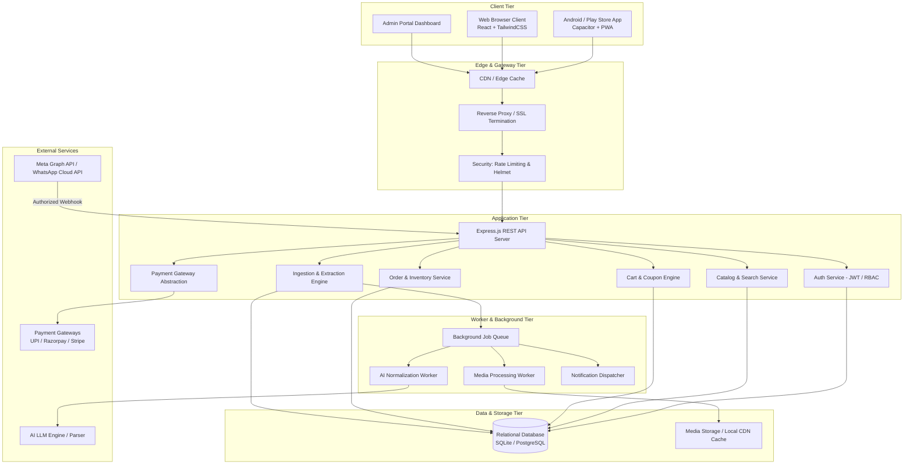
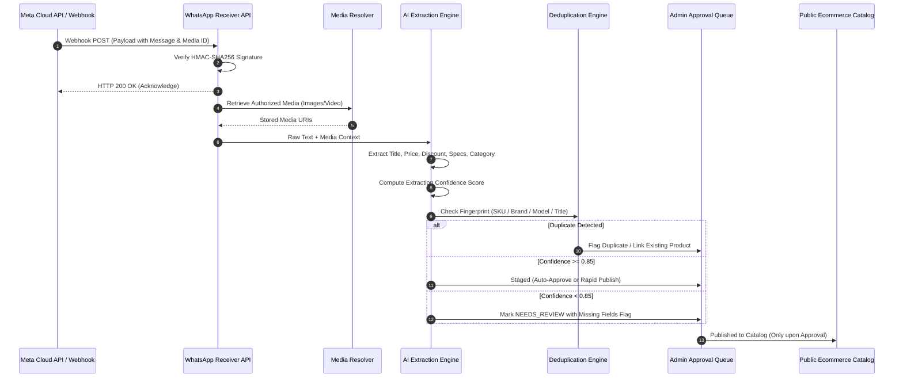

# GizmoVault — System Architecture Specification

## 1. System Overview & Architectural Principles

GizmoVault is designed as a modern, decoupled, multi-tier architecture capable of serving high-traffic consumer shopping clients on the web and Android devices (packaged for the Google Play Store), while simultaneously orchestrating real-time ingestion, AI extraction, and approval workflows from authorized WhatsApp Business sources.



---

## 2. Technology Stack Selection & Rationale

| Component | Selected Technology | Version / Spec | Rationale & Justification |
|---|---|---|---|
| **Client Framework** | React + TypeScript + Vite | React 19, TS 5.x, Vite 6 | Industry standard for high-performance Single Page Applications; lightning-fast HMR, strict type safety, zero bloat. |
| **Mobile Engine** | Capacitor + PWA | Capacitor 6+ | Seamless native Android APK/AAB wrapper for Google Play Store publication; supports native back-button, status bar, and camera/gallery while sharing 100% of web UI code. |
| **Styling & Design** | TailwindCSS + Vanilla CSS Variables | Tailwind 3.4+ | Modular utility-first design system; ensures dark mode, touch-friendly UI components, consistent spacing, and zero runtime CSS overhead. |
| **Icons & Media** | Lucide React | Latest | Clean, lightweight, consistent icon set optimized for modern mobile ecommerce. |
| **API Backend** | Node.js + Express.js + TypeScript | Node 22+ LTS | Battle-tested, event-driven I/O ideal for webhook ingestion, REST endpoints, and asynchronous pipeline handling. |
| **Database & ORM** | SQLite (`better-sqlite3`) / PostgreSQL | SQL Standard | SQLite provides instant zero-configuration, deterministic local development and automated testing; strict relational schema allows transparent deployment to PostgreSQL in production. |
| **Security Suite** | Helmet, bcrypt, jsonwebtoken, express-rate-limit | Production standards | Full protection against XSS, clickjacking, brute force, and injection attacks. |
| **Testing Suite** | Vitest + Supertest | Vitest 2.x | Blazing-fast test runner with native TypeScript and ESM support; verifies API contracts, ingestion logic, and calculations. |

---

## 3. Frontend / Mobile Architecture

The user interface follows a **Mobile-First Responsive Design Pattern** optimized for handheld touch devices and responsive up to desktop screens.

### 3.1 Mobile App Structure (Google Play Store Readiness)
- **Top Bar:** Location / Delivery pincode picker, search bar with voice/autocomplete triggers, and notification icon.
- **Main View Area:** Dynamic page container with smooth transitions between views.
- **Bottom Navigation Bar (Mobile):** 
  - `Home` (Featured gadgets, flash deals, category pills)
  - `Categories` (Accordion taxonomy of Electronics & Watches)
  - `Search` (Instant search with filter bottom sheet)
  - `Cart` (Badge indicator with live server item count)
  - `Profile` (Orders, addresses, account deletion, support)
- **Android Back-Button Behavior:** Hardware back-button pops current navigation stack (e.g. dismisses modals and filters before exiting views).

### 3.2 State Management
- Decoupled client state:
  - **Auth State:** Persistent token storage (Encrypted/Secure Storage on Android, LocalStorage with fallback on Web).
  - **Cart State:** Local optimistic updates backed by immediate server-side validation against current stock and active discounts.
  - **Filter State:** URL query-parameter bound for bookmarkable, shareable search results.

---

## 4. Backend & API Architecture

The backend follows a **Modular Controller-Service-Repository Pattern**:

```
src/
├── config/              # Environment variables, database connection, constants
├── controllers/         # HTTP request/response handlers
│   ├── auth.controller.ts
│   ├── product.controller.ts
│   ├── cart.controller.ts
│   ├── coupon.controller.ts
│   ├── checkout.controller.ts
│   ├── order.controller.ts
│   ├── payment.controller.ts
│   ├── whatsapp.controller.ts
│   ├── ingestion.controller.ts
│   └── admin.controller.ts
├── services/            # Core business logic
│   ├── auth.service.ts
│   ├── catalog.service.ts
│   ├── cart.service.ts
│   ├── pricing.service.ts
│   ├── order.service.ts
│   ├── payment.service.ts
│   ├── whatsapp-connector.service.ts
│   ├── ai-extractor.service.ts
│   ├── deduplication.service.ts
│   └── notification.service.ts
├── repositories/        # Database queries and data access layer
├── models/              # TypeScript interfaces and entity types
├── middleware/          # Auth guard, RBAC guard, validation, rate limiting, error handler
└── utils/               # Logger, crypto, validators, helpers
```

---

## 5. WhatsApp Ingestion & Content Processing Pipeline

To comply with Meta policies and maintain clean data boundaries, the ingestion pipeline is strictly decoupled from the live product catalog:



---

## 6. Payment Gateway Architecture

To satisfy both regional Indian payments and international payment options:
- **`PaymentProvider` Interface:**
  - `createOrder(orderId, amount, currency, metadata)`
  - `verifyPayment(paymentId, signature, orderId)`
  - `capturePayment(paymentId, amount)`
  - `processRefund(paymentId, amount, reason)`
  - `handleWebhook(payload, headers)`
- **Implementations:**
  - `MockPaymentProvider`: Deterministic sandbox gateway for local development, CI/CD, and simulated end-to-end purchasing flows.
  - `RazorpayPaymentProvider`: Indian market standard supporting UPI (Google Pay, PhonePe, Paytm), Credit/Debit cards, Net Banking, and Wallets.
  - `StripePaymentProvider`: International card processing and global payment methods.
- **Idempotency & Fraud Prevention:** Every webhook and confirmation request requires signature validation and updates the database transactionally. No order is ever marked `PAID` based on client-side messages alone.

---

## 7. Performance & Scalability Strategy

1. **Sub-100ms Product Browsing:** Category and search queries utilize composite B-Tree indexes on `(category_id, is_published, price)` and full-text indexes on titles and descriptions.
2. **Media Optimization Pipeline:** Incoming product images are compressed and converted into responsive WebP formats with pre-generated thumbnail dimensions (150x150, 400x400, 800x800).
3. **Optimistic UI with Server Truth:** Cart and Wishlist modifications respond instantaneously on the client while executing background sync; server responses authoritatively reconcile prices, stock, and coupon discounts.
4. **Stateless Clustering:** Backend processes hold zero session state in local memory; JWT tokens and shared database state enable seamless horizontal scaling.
