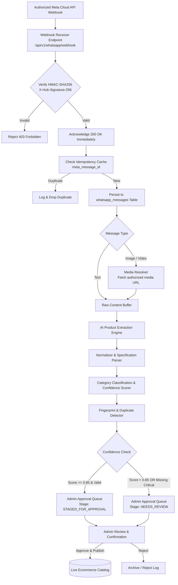

# GizmoVault — WhatsApp Ingestion & Meta Compliance Architecture

This document specifies the integration architecture connecting official Meta WhatsApp Business Platform webhooks with the GizmoVault product ingestion, AI extraction, and approval pipeline.

---

## 1. Compliance Principles & Boundary Guarantees

Per `GizmoVault.txt` Section 115 and Rules 7, 8:
1. **Zero Scraping / Zero Headless Automation:** GizmoVault will never employ unauthorized browser automation (Puppeteer/Playwright), reverse-engineered protocols, or scraper scripts against WhatsApp Web or private WhatsApp groups.
2. **Authorized Sources Only:** Only registered WhatsApp Business accounts (WABA), verified phone number IDs, and authorized vendor broadcast channels with consent are connected.
3. **Official Meta Graph API:** All incoming media (images and videos) are resolved via authenticated Meta Graph API calls using legitimate access tokens (`https://graph.facebook.com/v19.0/{media_id}`).
4. **Idempotency & Deduplication:** Webhook payloads are hashed and de-duplicated by `meta_message_id`. Re-delivered webhooks are safely acknowledged without duplicate product generation.
5. **Development Adapter:** In environments without active Meta Cloud credentials, the system executes against an authorized, typed `MockWhatsAppConnector` sandbox, permitting full end-to-end pipeline validation without fabricating API capabilities.

---

## 2. Ingestion Pipeline Architecture



---

## 3. WhatsAppConnector Interface Specification

All WhatsApp implementations implement the `WhatsAppConnector` TypeScript contract:

```typescript
export interface WhatsAppMessagePayload {
  metaMessageId: string;
  sourcePhoneNumberId: string;
  senderPhone: string;
  timestamp: string;
  type: 'text' | 'image' | 'video' | 'document';
  textBody?: string;
  caption?: string;
  mediaId?: string;
  mimeType?: string;
}

export interface ExtractedProductDraft {
  title: string;
  brand?: string;
  model?: string;
  category: string;
  subcategory?: string;
  originalPrice?: number;
  sellingPrice?: number;
  discountAmount?: number;
  discountPercent?: number;
  currency: string;
  specifications: Record<string, string>;
  description: string;
  tags: string[];
  mediaUrls: string[];
  confidenceScore: number;
  missingFields: string[];
}

export interface WhatsAppConnector {
  connect(): Promise<boolean>;
  validateCredentials(): Promise<boolean>;
  verifyWebhookSignature(rawBody: string, signature: string): boolean;
  parseWebhookPayload(body: any): WhatsAppMessagePayload[];
  retrieveAuthorizedMedia(mediaId: string): Promise<{ url: string; mimeType: string }>;
  acknowledgeMessage(metaMessageId: string): Promise<void>;
  handleError(error: Error, context: Record<string, any>): void;
}
```

---

## 4. Extraction & Normalization Engine

### 4.1 Sample Transformation Example

#### Incoming Vendor WhatsApp Broadcast:
```text
Original imported smartwatch
AMOLED display
Bluetooth calling
Heart-rate monitoring
7-day battery
Price ₹2,999
Discount ₹2,499
```

#### Extraction Output:
```json
{
  "title": "Imported Smartwatch AMOLED Bluetooth Calling",
  "category": "Imported Watches",
  "subcategory": "Smart Watches",
  "brand": "Imported",
  "model": "AMOLED Bluetooth Calling",
  "originalPrice": 2999.00,
  "sellingPrice": 2499.00,
  "discountAmount": 500.00,
  "discountPercent": 16.7,
  "currency": "INR",
  "specifications": {
    "Display": "AMOLED",
    "Connectivity": "Bluetooth Calling",
    "Health Monitoring": "Heart-rate monitoring",
    "Battery Life": "7 Days"
  },
  "description": "High-performance imported smartwatch featuring an AMOLED display, direct Bluetooth voice calling, heart-rate tracking, and an extended 7-day battery life.",
  "tags": ["smartwatch", "bluetooth", "AMOLED", "imported", "wearable", "fitness"],
  "confidenceScore": 0.94,
  "missingFields": []
}
```

### 4.2 Quality Gate & Protection Rules (Section 1576)
A product will **never** be auto-published if any of the following critical fields are missing or uncertain:
1. Product Title
2. Selling Price
3. Product Category
4. At least one usable high-resolution image
5. Product stock availability

If any critical field is missing, the product state is locked to `NEEDS_REVIEW` and flagged in the Admin Ingestion Center.

---

## 5. Deduplication & Idempotency Rules

When processing incoming messages:
1. **Message Deduplication:** `meta_message_id` has a unique constraint in `whatsapp_messages`. Re-received messages result in an immediate `200 OK` without triggering new extraction runs.
2. **Catalog Deduplication:**
   - The engine generates a composite fingerprint: `HASH(TRIM(LOWER(brand)) + TRIM(LOWER(model)) + TRIM(LOWER(category)))`.
   - If an existing product matches the fingerprint with high confidence (> 0.92), the system links the extraction as a **Price/Stock Update** for the existing product rather than inserting a duplicate item.
